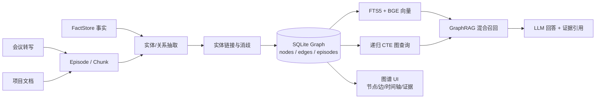

# meetingVAR 知识图谱搭建方案（调研 + 设计，2026-10-23）

## 0. 结论

**建议做，但不要“为了图谱而图谱”，也不要在 V1 上 Neo4j。**

meetingVAR 最适合的形态是：

> **在现有 FactStore + RAG 之上，增加一个本地、带时间、带证据的“项目上下文图”（Context Graph）**。  
> 图不是新的独立产品，而是事实、会议、文档、人物、决定、任务、风险之间关系的可查询投影。

技术路线：

- **存储**：SQLite 属性图（nodes / edges / episodes / aliases / vectors），与现有 `memory.sqlite3`、RAG、BGE 共部署；
- **查询**：SQLite 递归 CTE + FTS5 + BGE 向量 + LLM rerank；
- **抽取**：规则/现有事实先建图，再用本地 Qwen/自定义模型做严格 JSON 的实体关系抽取；
- **时间**：双时间（事件时间 + 入库时间）、`valid_from/valid_to`、`supersedes`、自动失效；
- **证据**：每条边必须能回到 turn_id / chunk_id / 事实来源，没有证据不建边；
- **GraphRAG**：图扩展只作为 RAG 的增强召回，不替换现有 chunk RAG；
- **UI**：Cytoscape.js 本地离线包，节点/边/时间轴/证据面板。

**不建议**直接引入 Neo4j、FalkorDB、Microsoft GraphRAG 或 Kùzu 作为核心依赖：

- Neo4j/FalkorDB 需要独立服务，和“干净 Windows、本地优先”冲突；
- Kùzu 官方 README 已标注项目归档（2026 现状），不适合作为新项目核心依赖；
- Microsoft GraphRAG 已进入维护模式，索引成本高，社区摘要对个人会议语料过重；
- LightRAG 的“双层次检索/增量更新”思想值得借鉴，但其默认存储不适合生产，整体替换会重复造现有 RAG 的轮子。

## 1. meetingVAR 为什么需要图

现有 RAG 擅长“找到相关段落”，但以下问题靠 chunk 相似度很弱：

| 用户问题 | RAG 的弱点 | 图能回答的方式 |
|---|---|---|
| 上次说周五交付，这次谁改了口？ | 两个片段都能召回，但“谁把哪个承诺改成什么”需要关系和时间 | `Action` 节点 + `assigned_to`/`due_on` 边 + 版本/失效 |
| A 风险会影响哪些任务？ | 需要跨会议、跨文档多跳 | `Risk -blocks-> Action`，再扩展到负责人/项目 |
| 这个项目谁参与最多？ | 片段里人名散落 | `Person -participates_in-> Meeting -about-> Project` 聚合 |
| 这个决定之前是什么？ | 旧片段可能被新片段淹没 | 边的 `valid_from/valid_to` + `supersedes` 链 |
| 这个人和哪些决定/风险有关？ | 只能按关键词碰运气 | 以 Person 为种子的 1–2 跳子图 |
| 两份文件/两场会议的说法矛盾吗？ | 相似度无法表达“矛盾” | 同主题边冲突检测 + 待确认队列 |

一句话：**RAG 找“文本”，图找“关系、路径、变化”。**

## 2. 现有资产怎么复用

meetingVAR 已经具备做图的基础，不需要从零开始：

| 现有资产 | 在图中的用途 |
|---|---|
| `FactStore` 的 decision/action/commitment/risk/open-question | 直接作为图节点种子 |
| `origin_meeting` / `source_refs` / `source_meetings` | episode 与证据链 |
| `RagIndex` 的 chunk_id / turn_ids / 时间戳 | 图边的事实来源 |
| `session transcript` + speaker | Person / Meeting / speaks_in 边 |
| `speaker_book` | 人物别名、说话人消歧 |
| `interest_context` / `terms.txt` | 项目、主题、专有名词的初始实体 |
| BGE embedding + FTS5 | 实体链接、节点检索、GraphRAG 混合召回 |
| 现有引用校验 | 图回答的 node/edge 引用校验 |

因此 V1 可以先从**已有事实和会议**构图，再逐步加 LLM 抽取。

## 3. 方案对比

| 方案 | 优点 | 缺点 | 结论 |
|---|---|---|---|
| **SQLite 属性图（推荐）** | 零服务、ACID、和现有项目同目录、FTS5/向量/递归 CTE 都能用 | 复杂图算法/超大图不如专用图库 | **V1 核心** |
| Neo4j | Cypher 成熟、生态好、GraphRAG 资料多 | JVM/服务/端口/安装/许可，违背本地优先 | 不作为 V1；未来企业版可选 |
| FalkorDB | Redis 模块、快、支持 Graphiti | 仍是外部服务/Docker | 不选 |
| Kùzu | 嵌入式、Cypher、列存、快 | 官方已归档，扩展生态变化 | 不选为新依赖 |
| LightRAG | 双层次检索、增量、成本比 GraphRAG 低 | 自带完整存储栈，默认存储不适合生产；替换现有 RAG | 借鉴思想，不整体引入 |
| Microsoft GraphRAG | 社区摘要、全局问题强 | 维护模式、索引贵、个人会议过重 | 不选 |
| RDF/SPARQL | 标准、互操作 | 建模/查询/LLM 抽取都更重 | 不需要 |
| NetworkX | 算法丰富、上手快 | 内存态、无事务、无持久化 | 只做离线分析，不做事实源 |

**推荐：SQLite 属性图 + 预留 `GraphStore` 接口。**  
如果未来单项目超过约 10 万节点/100 万边，或需要复杂图算法，再把读模型迁到专用图库；事实源和证据仍在 SQLite/Markdown。

## 4. 目标架构



数据流：

```text
会议结束
  → 转写分段（已有）
  → 规则/LLM 抽实体与关系（新增）
  → 实体链接（别名/说话人/项目词表/BGE）
  → 边证据校验（turn_id/quote）
  → 去重、时间化、冲突检测
  → SQLite 图 + FTS/向量索引
  → Agent 工具/GraphRAG/UI
```

## 5. 本体（V1 只做小词表）

不要一开始做开放式本体。V1 固定 12 类节点、18 类关系，保证 LLM 输出可控。

### 节点类型

| 类型 | 例子 |
|---|---|
| `Person` | 张三、小林、王工 |
| `Team` | 数据组、前端组、客户方 |
| `Project` | 星河项目、meetingVAR |
| `Meeting` | 2026-03-11 高微第 2 节 |
| `Decision` | 采用第二方案 |
| `Action` | 周五交付第一版 |
| `Commitment` | 王五承诺给出接口 |
| `Risk` | 外部接口延期 |
| `OpenQuestion` | 是否采购 GPU |
| `Requirement` | 客户要求数据导出 |
| `Topic` | 测试、预算、上线 |
| `Document` | 需求.md、会议纪要 |
| `Artifact` | 接口定义、数据表、版本 |
| `Date` | 11 月 15 日、周五 |

### 关系类型

| 关系 | 头 → 尾 |
|---|---|
| `assigned_to` | Action/Commitment → Person |
| `owned_by` | Project/Task → Person/Team |
| `member_of` | Person → Team |
| `participates_in` | Person → Meeting |
| `speaks_in` | Person → Meeting |
| `about` | Meeting/Document → Project/Topic |
| `decided_in` | Decision → Meeting |
| `derived_from` | Decision/Action → Meeting/Document |
| `supersedes` | Decision/Action/Edge → 旧节点/旧边 |
| `contradicts` | 节点/边 → 节点/边 |
| `depends_on` | Action/Artifact → Action/Artifact |
| `blocks` | Risk → Action/Project |
| `mitigates` | Action → Risk |
| `due_on` | Action/Commitment → Date |
| `part_of` | Topic/Artifact → Project |
| `references` | Document/Meeting → Document |
| `caused_by` | Risk/Issue → Event/Decision |
| `resolves` | Action/Decision → OpenQuestion/Risk |
| `related_to` | 兜底弱关系，低权重 |

原则：

- 关系名用英文稳定标识，UI 显示中文；
- 每段最多 30 个实体、40 条边，避免小模型输出爆炸；
- 不抽“泛泛相关”，`related_to` 只作为低置信兜底；
- 每条边至少 1 个 evidence turn/chunk；没有证据不落库。

## 6. SQLite 图 schema

数据库：`<项目>/meetingvar/kg/graph.sqlite3`（可重建，事实源仍 Markdown/转写）。

```sql
CREATE TABLE kg_nodes (
  id TEXT PRIMARY KEY,
  kind TEXT NOT NULL,
  name TEXT NOT NULL,
  canonical_name TEXT NOT NULL,
  aliases_json TEXT NOT NULL DEFAULT '[]',
  description TEXT DEFAULT '',
  status TEXT NOT NULL DEFAULT 'active', -- active/provisional/merged/deleted
  confidence REAL DEFAULT 0.8,
  created_at TEXT NOT NULL,
  updated_at TEXT NOT NULL
);

CREATE TABLE kg_edges (
  id TEXT PRIMARY KEY,
  src_id TEXT NOT NULL,
  dst_id TEXT NOT NULL,
  relation TEXT NOT NULL,
  label TEXT DEFAULT '',
  status TEXT NOT NULL DEFAULT 'asserted', -- asserted/superseded/retracted/pending
  valid_from TEXT NOT NULL,
  valid_to TEXT DEFAULT '',
  observed_at TEXT NOT NULL,
  confidence REAL DEFAULT 0.8,
  source_type TEXT NOT NULL,             -- meeting/document/fact/chat
  source_id TEXT NOT NULL,               -- session_id / path / fact name
  session_id TEXT DEFAULT '',
  chunk_id TEXT DEFAULT '',
  turn_ids_json TEXT NOT NULL DEFAULT '[]',
  quote TEXT DEFAULT '',
  extractor TEXT NOT NULL,
  supersedes TEXT DEFAULT '',
  metadata_json TEXT NOT NULL DEFAULT '{}'
);

CREATE TABLE kg_episodes (
  id TEXT PRIMARY KEY,
  source_type TEXT NOT NULL,
  source_id TEXT NOT NULL,
  session_id TEXT DEFAULT '',
  occurred_at TEXT NOT NULL,
  content_hash TEXT NOT NULL,
  text TEXT NOT NULL
);

CREATE TABLE kg_aliases (
  alias TEXT NOT NULL,
  node_id TEXT NOT NULL,
  source TEXT DEFAULT '',
  confidence REAL DEFAULT 0.8,
  PRIMARY KEY (alias, node_id)
);

CREATE TABLE kg_node_vectors (
  node_id TEXT PRIMARY KEY,
  model TEXT NOT NULL,
  dim INTEGER NOT NULL,
  vector BLOB NOT NULL
);

CREATE TABLE kg_edge_vectors (
  edge_id TEXT PRIMARY KEY,
  model TEXT NOT NULL,
  dim INTEGER NOT NULL,
  vector BLOB NOT NULL
);

CREATE INDEX idx_edges_src ON kg_edges(src_id, relation, status);
CREATE INDEX idx_edges_dst ON kg_edges(dst_id, relation, status);
CREATE INDEX idx_edges_valid ON kg_edges(valid_from, valid_to);
CREATE INDEX idx_nodes_kind ON kg_nodes(kind, status);
```

FTS5：

```sql
CREATE VIRTUAL TABLE kg_nodes_fts USING fts5(
  node_id UNINDEXED, name, aliases, description, tokenize='unicode61'
);
```

中文仍用现有 bigram 分词；节点/边向量复用 BGE。

### 递归查询示例

“以某人为种子，找 2 跳内的项目和任务”：

```sql
WITH RECURSIVE reach(id, depth, path) AS (
  SELECT ? AS id, 0 AS depth, ? AS path
  UNION ALL
  SELECT e.dst_id, r.depth + 1, r.path || '>' || e.dst_id
  FROM reach r
  JOIN kg_edges e ON e.src_id = r.id
  WHERE r.depth < 2
    AND e.status = 'asserted'
    AND (e.valid_to = '' OR e.valid_to > ?)
    AND instr(r.path, e.dst_id) = 0
)
SELECT n.* FROM reach r JOIN kg_nodes n ON n.id = r.id
WHERE n.kind IN ('Project', 'Action', 'Risk')
ORDER BY r.depth;
```

复杂图算法（社区发现、PageRank）后续用 NetworkX 离线跑，不放在请求路径。

## 7. 抽取与入库

### 7.1 输入分块

- 会议：复用 RAG 的 chunk（turn 范围 + 时间戳），每次 600–900 字；
- 文档：复用 `RagIndex` 的 chunk；
- 事实：直接把 FactStore 的 fact 作为一条 episode/种子。

### 7.2 LLM 输出 schema

严格 JSON，禁止自由文本：

```json
{
  "entities": [
    {
      "surface": "小林",
      "kind": "Person",
      "aliases": ["林工"],
      "evidence_turn_ids": ["turn_12"],
      "confidence": 0.9
    }
  ],
  "relations": [
    {
      "head": "小林",
      "relation": "assigned_to",
      "tail": "周五交付第一版",
      "evidence_turn_ids": ["turn_12"],
      "valid_from": "2026-03-11",
      "confidence": 0.85
    }
  ]
}
```

校验：

1. `kind`/`relation` 必须在白名单；
2. evidence ID 必须来自当前 chunk；
3. 引文必须能在 turn/chunk 原文中找到；
4. 关系头尾必须能解析到实体；
5. 低置信/歧义实体标 `provisional`，不参与高置信回答；
6. 不合格的条目丢弃并记录错误，不让模型“补全”。

### 7.3 实体链接

顺序：

1. 精确别名/规范化名称；
2. 同类型 + BGE 余弦 ≥ 0.82；
3. 0.65–0.82 的灰区交给 LLM 二选一（“是否同一实体”）；
4. 仍不确定 → 新建 provisional 节点 + 合并队列。

别名来源：

- speaker_book / 会议点名；
- 项目词表、`interest_context`；
- 文档中的缩写（如“高微2”）；
- 人工在 UI 合并。

### 7.4 时间与冲突

- `valid_from`：事件发生时间（会议日期/文档日期），不是写库时间；
- `valid_to`：被新事实替代/取消/过期的时间；
- `observed_at`：入库时间（双时间，便于审计“我们何时知道”）；
- 新边与旧边同 src/relation/dst 且时间重叠时：
  - 明确改口 → 旧边 `valid_to=event_time`，新边 `supersedes=旧边`；
  - 不确定 → 新边 `status=pending`，进入冲突队列；
  - 同一事实重复提及 → 合并证据，不新增边。

## 8. GraphRAG 检索

不要用图替换 RAG，而是：

```text
query
 → 实体链接（FTS + BGE + 别名）
 → 种子节点 top 3
 → 1–2 跳子图（按关系类型/时间/status 过滤）
 → 拉取边证据 + 关联 chunk/fact
 → 混合打分：实体匹配 + 边置信 + 路径长度 + 时间新近 + RAG 相似度
 → LLM rerank
 → 生成答案 + node/edge/chunk 引用
```

三种模式：

| 模式 | 用途 |
|---|---|
| `local` | “谁负责 X / X 的状态” → 实体邻域 |
| `temporal` | “上次/这次/之前是什么” → as_of / changed_between |
| `path` | “A 和 B 怎么关联” → 1–3 跳路径 |

暂不做 Microsoft 式社区摘要；个人会议语料不需要全局社区报告。以后数据量到数千会议，再加社区检测/摘要作为可选层。

## 9. Agent 工具与 UI

新增只读工具：

- `kg_find_entities(query, kind?)`
- `kg_neighbors(node_id, relation?, depth=1)`
- `kg_path(src_id, dst_id, max_depth=3)`
- `kg_timeline(node_id)`：返回带 valid_from/to 的边
- `kg_search(query, as_of?)`：GraphRAG 混合检索
- `kg_merge_entities` / `kg_review_edge`：写操作，必须审批

回答引用新增：

```json
{"kind":"node","node_id":"..."}
{"kind":"edge","edge_id":"...","quote":"...","session_id":"...","turn_ids":["turn_12"]}
```

UI：

- 项目页新增“知识图谱”标签；
- Cytoscape.js（MIT）离线渲染；
- 左侧过滤：节点类型、关系、时间、置信度、只显示 active；
- 点击节点：实体卡（别名、事实、会议、邻居、时间线）；
- 点击边：证据引文 + 跳到会议原句 / RAG chunk；
- 时间轴滑块：查看“某天时的图”；
- 冲突队列：pending 边三选一（采用/拒绝/合并）。

## 10. 分阶段实施

### Phase 0（最小可用，1–2 天）

- `kg/schema.py` + `kg/store.py`：SQLite 表、FTS、BGE 向量、CRUD、递归查询；
- 从现有 FactStore 和 SessionCatalog 规则化建图：
  - Decision/Action/Risk/Commitment/OpenQuestion 节点；
  - Person 从 owner/speaker；
  - Meeting/Project 节点；
  - `decided_in`/`assigned_to`/`due_on`/`derived_from` 边；
- 单元测试：节点/边、时间、证据、路径。

### Phase 1（会议抽取，3–5 天）

- `kg/extract.py`：严格 JSON 抽取 + turn 证据校验；
- `kg/link.py`：别名 + BGE + LLM 灰区消歧；
- 会后流水线：转写 chunk → 抽取 → 入库；
- 20 场会议人工抽查 precision/recall。

### Phase 2（GraphRAG + Agent，3–4 天）

- `kg/query.py`：local/temporal/path；
- `kg/graphrag.py`：图扩展 + RAG chunk + rerank；
- Agent 工具、引用校验、Chat 路由；
- 与现有 `search_memory`/`search_project_knowledge` 统一入口。

### Phase 3（UI，3–4 天）

- Cytoscape 离线包、图视图、时间轴、证据面板；
- 实体合并、边冲突审核；
- 大图性能：默认 1 跳、节点上限、懒加载。

### Phase 4（质量与规模化，1–2 周）

- 实体链接 golden set；
- 关系抽取 P/R、时间一致性、路径 QA；
- GraphRAG A/B：RAG-only vs RAG+KG；
- 10k 会议/100 万边压力测试，决定是否迁图库。

## 11. 评测指标

| 维度 | 指标 | 目标（V1） |
|---|---|---|
| 实体抽取 | precision / recall / F1 | ≥0.80 / ≥0.70 / ≥0.75 |
| 关系抽取 | precision / recall | ≥0.75 / ≥0.65 |
| 实体链接 | 正确合并率 / 错误合并率 | ≥0.90 / ≤0.03 |
| 时间 | 失效/有效期正确率 | ≥0.90 |
| 路径问答 | 1–2 跳正确率 | ≥0.80 |
| GraphRAG | 答案正确率、引用支持率 | 相对 RAG-only 提升 ≥10% |
| 性能 | 查询 p50 / p95 | <150ms / <500ms |
| 成本 | 每场会议抽取 token/耗时 | 可配置、可缓存 |

评测集：

- 现有 12 条考试关注问题 + 会议证据 benchmark；
- 20 场会议人工标注 50 个实体/50 条边；
- 50 条图问答（谁负责/变化/路径/风险影响/时间）。

## 12. 主要风险

1. **LLM 抽取幻觉**：必须要求 evidence turn + 原文引用校验；宁缺毋滥。
2. **实体错误合并**：灰区必须人工/LLM 复核，保留 merge/split 审计。
3. **时间混乱**：相对时间（周五/下周）必须用会议日期归一化；双时间字段。
4. **图膨胀**：关系词表白名单、每 chunk 上限、低置信边不进主图。
5. **UI 大图卡顿**：默认 1 跳、节点上限、按需加载、Cytoscape 离线包。
6. **隐私**：图按项目隔离；删除会议/事实级联删边；不引入外部图服务。

## 13. 不做什么

- 不把 Neo4j/FalkorDB 作为桌面版必需依赖；
- 不引入已归档的 Kùzu 作为新核心；
- 不用 Microsoft GraphRAG 的社区摘要作为 V1；
- 不让 LLM 无证据写节点/边；
- 不把 NetworkX 当持久化事实源；
- 不建开放式本体（先 12 类节点 + 18 类关系）。

## 14. 推荐的第一步

先做 **Phase 0**：不调用 LLM，仅用现有 FactStore + 会议/说话人规则建图，接 3 个查询工具（`kg_neighbors`、`kg_timeline`、`kg_path`）和最小图视图。  
这样能在一两天内验证“图是否真的比 RAG 更好地回答关系/变化问题”，再决定是否投入 LLM 抽取。

如果 Phase 0 的评测显示图查询没有明显增益，就停在“事实/RAG 的关系索引”，不要继续堆 GraphRAG。