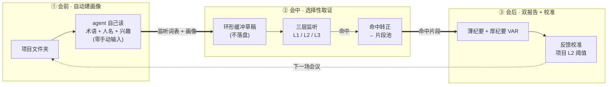
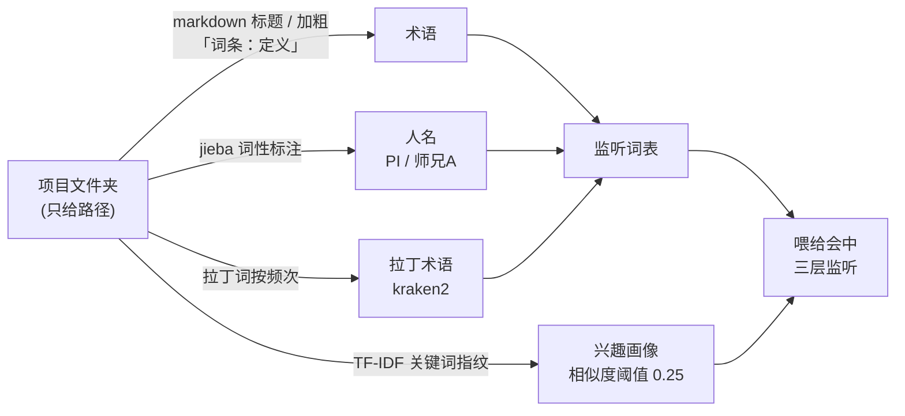
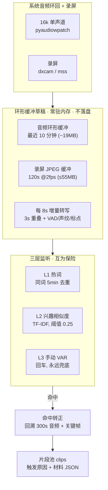
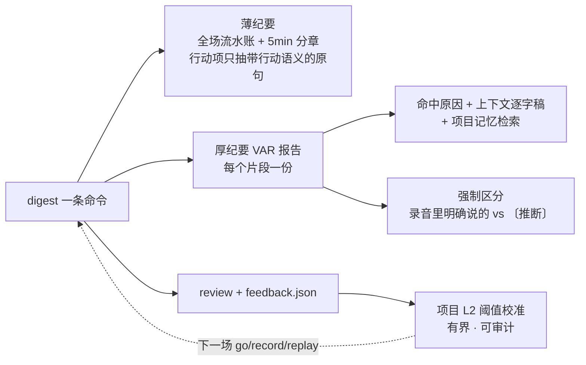
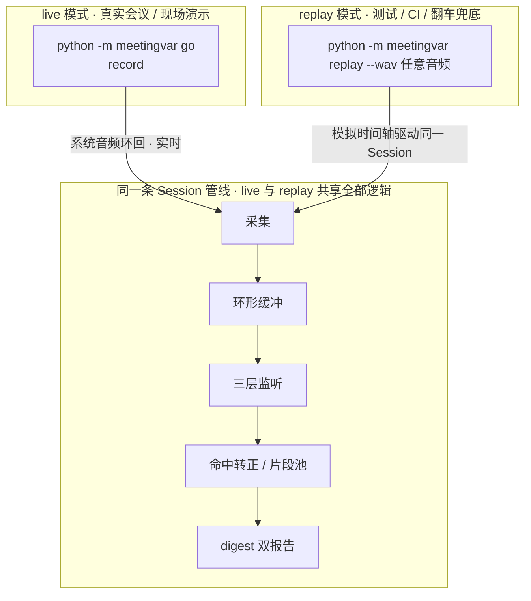

# meetingVAR 工作模式示意

> 一句话定位：装在你自己电脑上的「会议取证器」。平时像一台开着但不写卡的行车记录仪；一旦会议里聊到你关心的东西（它从你的项目记忆里自己学来的），它就把「刚才那一会儿」的完整证据——声音和屏幕——保存下来。
>
> 本图基于代码实际实现整理，事实与 `docs/overview.md`、`docs/pool_schema.md`、`docs/EVIDENCE_SKILLS_0.17.0.md` 保持一致；未做环节如实标注「兜底 / 未做」。

---

## 0. 总览：一个「选择性取证」的循环

三段（会前 / 会中 / 会后）串成一个循环，会后反馈校准回流到下一场会前：



> 关键差异点：**默认不保存，永远「差一点就保存了」**——草稿只在内存环形缓冲里，命中才转正写盘。这是「选择性取证」而非「全量录屏」的根。

---

## 1. 会前 · 自动建画像（零手动输入）

只给一个项目文件夹路径，agent 自己读，产出会中三层监听的词表和兴趣指纹：



- 用户**手动热词是覆盖项，不是必选项**：可以手动补，但没补也能靠自动抽取跑。
- 兴趣阈值默认 `0.25`，会后反馈校准可小步长、有界地调整（见 §4）。

---

## 2. 会中 · 常驻草稿 + 三层监听 + 命中转正

这是整个系统的主干。系统音频环回（WASAPI 混音台分线）+ 录屏，常驻内存，**命中才写盘**：



**本地识别四件套**（每 8s 一个增量块，FunASR，非字级流式）：

| 模型 | 职责 |
|---|---|
| `fsmn-vad` | 先切「有人在说话」的段，沉默跳过 |
| `SenseVoiceSmall` | 识别主体（非自回归） |
| `CAM++` | 声纹指纹，按句标 `spk0/spk1` |
| `punc_ct-transformer` | 给无标点草稿补标点 |

> 终端速览（会中核心循环，ASCII）：
>
> ```text
>  系统音频环回 + 录屏
>        │
>        ▼
>  环形缓冲草稿（常驻内存，不落盘）
>   · 音频最近 10min · 录屏 120s@2fps · 每 8s 增量转写
>        │
>        ▼
>  三层监听  L1 热词 / L2 兴趣相似度 / L3 回车手动
>        │ 命中
>        ▼
>  命中转正：回溯 300s 音频 + 关键帧  →  片段池 clips
> ```

- 音频回溯窗默认 `300s`，可用 `MEETINGVAR_LOOKBACK` 配置；屏幕取帧受 120s 缓冲限制——更早的回溯音频不会凭空补出画面。
- 说话人编号是窗口内声纹结果，**不能视为跨窗口真人身份**（诚实边界）。

---

## 3. 会后 · 双报告 + 反馈校准

一条 `digest` 命令出两份报告，review 反馈回流校准：



- 配了 LLM 环境变量出叙述版，没配出结构化模板版并**如实标注〔模板版〕**。
- 反馈校准 v1 是有界、可审计的启发式（样本/阈值写进 `<项目>/meetingvar/calibration.json`），**尚非统计学习**；L1/L3 不参与。

---

## 4. 运行模式 · live vs replay

两条入口共享**同一条 Session 管线**——这是测试与演示的兜底路径：



| 维度 | live | replay |
|---|---|---|
| 入口 | `go` / `record` | `replay --wav 任意音频` |
| 时间轴 | 真实时钟 | 模拟时间轴驱动同一 Session |
| 用途 | 真实会议采集、现场演示 | 单元测试、model-free CI、现场 ASR 失败兜底 |
| 共享逻辑 | 全部管线（缓冲/监听/转正/报告）一致 | 同左 |
| 现场策略 | 首选；麦克风失败就用预录音频走 replay 环回 | 兜底路径（对应 5 分钟 demo 的 fallback） |

> 现场若 ASR / 麦克风失败：直接播放预录的会议音频（系统环回）走 replay，不进 live 死等。

---

## 延伸 · 命中片段之上的三个证据技能

命中片段（clip）是证据技能的原料。详细数据契约见 `docs/EVIDENCE_SKILLS_0.17.0.md`：

| 技能 | 干什么 | 数据来源优先级 |
|---|---|---|
| **Evidence Pack** | 把命中片段变成可校验证据包（ZIP + manifest + SHA256） | session + clip → 待确认动作卡 |
| **Commitment Ledger** | 承诺账本，回答「谁改了口、原话是什么」 | FactStore 版本快照（due/owner/status） |
| **Find Moment** | 自然语言找回具体 30–90s 片段 | RAG meeting chunks → 目录关键词 → 邻近 clip |

> 证据包是**写文件动作**，必须走聊天确认卡，不作为自由工具，模型不能直接往磁盘写 ZIP。

---

## 诚实边界（比赛要求「说明哪些环节真实实现」）

- **已验证**：107 项轻量回归、实际视频编码、模拟 LLM 契约与反馈闭环；真实 CPU 环境跑通系统环回 / 录屏 / CLI `go` / L1·L2·L3 / 报告归档。
- **兜底而非真实**：replay 是模拟时间轴驱动同一管线，用于测试与演示，不是真会议。
- **未做 / 已知局限**：尚无托盘/悬浮条/会后 GUI；真实腾讯会议/微信会议仍待人工实测；本机 GPU 加速未部署；字级流式未做；厚纪要真实 LLM 质量无服务配置时只出模板版。
- **不虚构指标**：无人工转写稿 → 不报 CER/WER；无人工标注 → 不报实体 P/R；无真实用户 → 不报满意度。
